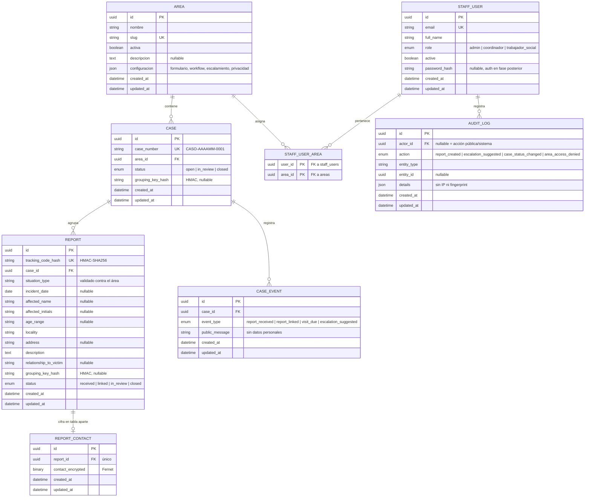

# Modelo de datos

Implementado en **Fase 1 (modelo multi-área)**. Base de datos: PostgreSQL en producción/Docker; SQLite para desarrollo local y tests. El diseño es genérico: las reglas de cada área viven en `areas.configuracion` (JSON), no en el código.

## DER



## Tablas

### `areas`

Cada área delimitada por la Oficina de Desarrollo Social: adultos mayores, violencia de género, niñez y adolescencia, diversidad sexual y de género, abuso laboral.

| Campo | Tipo | Observaciones |
| --- | --- | --- |
| `id` | UUID | PK. UUID determinista por slug (`uuid5`). |
| `nombre` | string(120) | Nombre visible. |
| `slug` | string(64) | Único; identifica el formulario público (`/api/reports/{area_slug}`). |
| `activa` | boolean | Un área inactiva no aparece en `/api/areas` ni acepta denuncias. |
| `descripcion` | text | Opcional. |
| `configuracion` | JSON / JSONB | Ver [Configuración por área](#configuración-por-área). |
| `created_at`, `updated_at` | datetime | UTC. |

### `cases`

Un caso concentra una o varias denuncias sobre la misma situación y dirección **dentro de un área**.

| Campo | Tipo | Observaciones |
| --- | --- | --- |
| `id` | UUID | PK. |
| `case_number` | string(32) | Único. Formato `CASO-AAAAMM-0001`. |
| `area_id` | UUID | FK a `areas.id` (`RESTRICT`), obligatoria. Nunca se agrupan casos de áreas distintas. |
| `status` | enum | `open` por defecto; los estados permitidos y sus transiciones se definen por área. |
| `grouping_key_hash` | string(64) | HMAC de la clave de agrupación; no es único. |
| `created_at`, `updated_at` | datetime | UTC. |

### `reports`

Cada envío del formulario público. **No contiene IP, user-agent, fingerprint ni ningún dato identificatorio del denunciante**. Los campos de la persona afectada dependen del área: las áreas con anonimato reforzado no piden nombre completo.

| Campo | Tipo | Observaciones |
| --- | --- | --- |
| `id` | UUID | PK. |
| `tracking_code_hash` | string(64) | Único. HMAC-SHA256 del código; el código en claro se devuelve **una sola vez** y nunca se persiste. |
| `case_id` | UUID | FK a `cases.id` (`RESTRICT`). |
| `situation_type` | string(64) | Tipo de situación; los valores válidos salen de `configuracion.form.situation_types`. |
| `incident_date` | date | Opcional, no puede ser futura. |
| `affected_name` | string(200) | Opcional; solo se pide donde la política de privacidad lo permite. |
| `affected_initials` | string(10) | Opcional; alternativa de mínimos datos en niñez. |
| `age_range` | string(32) | Opcional; los rangos los define cada área (mayores, menores, etc.). |
| `locality` | string(120) | Localidad del hecho, obligatoria en el formulario base. |
| `address` | string(256) | Opcional; sin dirección no se agrupa automáticamente. |
| `description` | text | Relato de los hechos (20 a 4000 caracteres). |
| `relationship_to_victim` | string(64) | Opcional; valores de `configuracion.form.relationship_options`. |
| `grouping_key_hash` | string(64) | HMAC de la clave usada, si aplica. |
| `status` | enum | `received` o `linked` según se creó o se asoció a un caso existente. |
| `created_at`, `updated_at` | datetime | UTC. |

### `report_contacts`

Contacto voluntario de quien informa, **cifrado con Fernet y aislado de `reports`**. No se guarda si no se completa el campo.

| Campo | Tipo | Observaciones |
| --- | --- | --- |
| `id` | UUID | PK. |
| `report_id` | UUID | FK a `reports.id` (`CASCADE`), único (1:1). |
| `contact_encrypted` | binary | Token Fernet con dominio `contact:v1:`. |
| `created_at`, `updated_at` | datetime | UTC. |

### `case_events`

Historial público del caso, sin datos personales; se expone por código de seguimiento. Los tipos `visit_due` y `escalation_suggested` son **sugerencias** generadas desde la configuración del área, nunca acciones automáticas.

| Campo | Tipo | Observaciones |
| --- | --- | --- |
| `id` | UUID | PK. |
| `case_id` | UUID | FK a `cases.id` (`CASCADE`). |
| `event_type` | enum | `report_received`, `report_linked`, `visit_due`, `escalation_suggested`. |
| `public_message` | string(200) | Mensaje apto para la consulta pública. |
| `created_at`, `updated_at` | datetime | UTC. |

### `staff_users` y `staff_user_areas`

Personal de la Oficina. Roles: `admin`, `coordinador`, `trabajador_social`. Un usuario tiene una o más áreas asignadas; `visible_cases()` filtra los casos por esas áreas y por la política `privacy.panel_access` del área. La autenticación se implementa en una fase posterior (`password_hash` queda preparado).

### `audit_logs`

Trazabilidad interna de acciones, sin IP ni fingerprint. `actor_id` nulo indica acción pública/sistema. Las sugerencias de escalamiento registran `requires_human_confirmation: true` en `details`.

## Configuración por área

`areas.configuracion` se valida al leerlo con `AreaConfig` (`app/schemas/area_config.py`):

```json
{
  "form": {
    "situation_types": [{ "value": "abuse", "label": "Maltrato físico o psicológico" }],
    "relationship_options": [{ "value": "family", "label": "Familiar" }],
    "fields": {
      "situation_type": { "label": "Tipo de situación", "visible": true, "required": true },
      "description": { "label": "Relato de los hechos", "visible": true, "required": true },
      "locality": { "label": "Localidad", "visible": true, "required": true },
      "affected_name": { "label": "Nombre de la persona afectada", "visible": true, "required": true },
      "age_range": {
        "label": "Rango de edad",
        "visible": true,
        "required": true,
        "choices": [{ "value": "range_70_79", "label": "70 a 79 años" }]
      }
    }
  },
  "workflow": {
    "initial_status": "open",
    "transitions": {
      "open": ["in_review", "closed"],
      "in_review": ["open", "closed"],
      "closed": []
    }
  },
  "escalation": {
    "visit_after_reports": 1,
    "alert_threshold": 3,
    "alert_action": "suggest_police",
    "requires_human_confirmation": true
  },
  "privacy": {
    "anonymity": "standard",
    "panel_access": "standard",
    "allowed_roles": ["admin", "coordinador", "trabajador_social"]
  }
}
```

- `form` define campos visibles/obligatorios y opciones válidas. Los campos no incluidos se rechazan con 422 (`extra="forbid"` + validación contra el área).
- `workflow` define el estado inicial y las transiciones permitidas; el panel deberá validarlas con `assert_transition_allowed`.
- `escalation` es **nullable**. Solo adultos mayores la define, con la regla `1 denuncia = visita sugerida`, `3 denuncias = alerta sugerida a policía`. `requires_human_confirmation` no puede ser `false`; la única acción automática posible es una sugerencia (`alert_action: suggest_police`). Ningún endpoint notifica a la policía ni cambia estados por umbral.
- `privacy.anonymity` puede ser `standard` o `reinforced`; `panel_access: restricted` excluye al rol `trabajador_social`.

### Cobertura por área

| Área | Formulario | Escalamiento | Privacidad |
| --- | --- | --- | --- |
| Adultos mayores | Completo: nombre, rango etario, relación, situación | `1` visita / `3` alerta (config) | Estándar |
| Violencia de género | Base + relación con la víctima | Sin umbral | Estándar |
| Niñez y adolescencia | Base sin nombre: iniciales y rangos de menores | Sin umbral | Reforzada, panel restringido |
| Diversidad sexual y de género | Base sin nombre ni datos de identidad de terceros | Sin umbral | Reforzada, panel restringido |
| Abuso laboral | Base + relación laboral | Sin umbral | Estándar |

## Pantalla inicial del formulario público

`GET /api/areas` devuelve las áreas activas con sus campos y opciones, más:

- `notice`: aviso de que la plataforma **no es para emergencias**.
- `emergency_lines`: **911**, **144** (violencia de género) y **102** (niñez), siempre visibles en cualquier área.

## Código de seguimiento

- Formato `CUID-XXXX-XXXX-XXXX` (alfabeto sin `0`, `1`, `O`, `I`).
- Generado con `secrets`, devuelto una sola vez en la creación.
- Solo se persiste `HMAC-SHA256(code, TRACKING_CODE_PEPPER)` con dominio `tracking-code:v1:`.
- La consulta normaliza mayúsculas/espacios, valida el formato y busca por hash; un código inexistente devuelve 404 genérico.

## Agrupación en casos

1. Se normalizan localidad, dirección y (si el área lo permite) nombre: minúsculas, sin acentos, espacios colapsados.
2. La clave es `HMAC(area_id|localidad|dirección|nombre, TRACKING_CODE_PEPPER)` con dominio `grouping:v2:`.
3. Sin dirección no se agrupa (se crea un caso nuevo) para evitar falsos positivos.
4. Se reutiliza solo un caso `open` o `in_review` **del mismo área**; la denuncia entra con estado `linked` y se agrega el evento `report_linked`, si no, se crea un caso con `report_received`.
5. Al alcanzar un umbral configurado se agrega un evento de sugerencia y una entrada de auditoría. No hay fusión manual ni escalamiento automático en esta fase.

## Adjuntos y EXIF

No se aceptan archivos en Fase 1, por lo que no existe superficie de metadatos EXIF. Cuando se habiliten adjuntos, deberán pasar por limpieza de metadatos antes de persistirse.

## Migraciones

- `a148dfeb064b_reporting_schema.py`: esquema inicial (`cases`, `reports`, `case_events`).
- `f3b1c7d9e2a4_multi_area.py`: crea `areas`, `report_contacts`, `staff_users`, `staff_user_areas` y `audit_logs`; backfillea `cases.area_id` con adultos mayores; mueve el contacto cifrado a su tabla; convierte `category`/`affected_age_range` a strings configurables; amplía los eventos; incluye `downgrade`.
